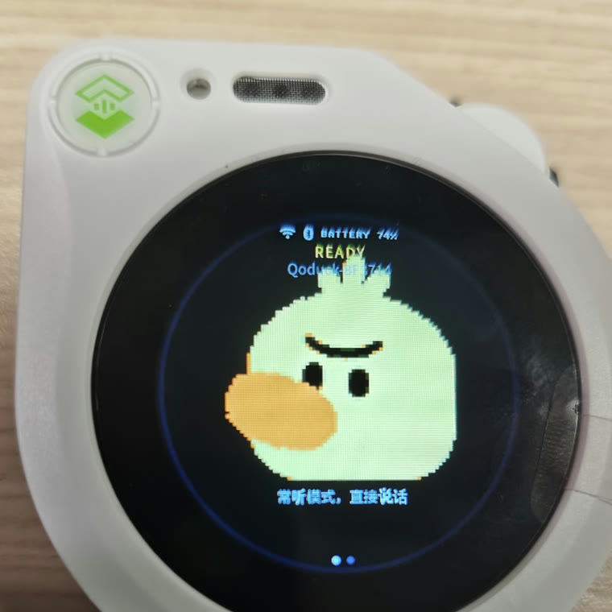

# Qoduck — a Qoder Cloud Agents voice gadget

**English** · [简体中文](README.zh-CN.md)

Talk to [Qoder Cloud Agents](https://docs.qoder.com) through a small desk device: press nothing,
just speak, and the agent answers out loud while a duck face reacts on the screen.

This firmware runs on a **Seeed SenseCAP Watcher** (ESP32-S3 + OV5647 camera + mic + speaker +
round LCD). It is a fork of
**[facebookincubator/muse-gadget-sdk](https://github.com/facebookincubator/muse-gadget-sdk)**
(Apache-2.0): the Muse cloud link (`hatch.metaaivm.com`) is removed and replaced by a direct
WebSocket voice link to `api.qoder.com`.

<p align="center">
  
</p>
<p align="center"><sub>SenseCAP Watcher running this firmware: always-listening, the duck reacts while the agent talks</sub></p>

---

## What it does

```
 mic ──► VAD ──► 16 kHz PCM ──┐
                              │  wss://api.qoder.com/api/v1/forward/realtime
 speaker ◄── 24 kHz PCM ◄─────┘  (Qoder Cloud Agent session)
```

* **Always-listening by default.** The device VAD opens the uplink when you speak; the agent's
  server-side VAD/ASR/LLM/TTS streams audio back. Measured **1.0–2.5 s** from end of speech to
  first audio frame.
* **On-device UI.** A round LCD shows a duck face that breathes, blinks, sways while talking and
  squints when thinking. The scroll wheel is the only button: tap it to pet the duck, double-tap to
  dizzy it, turn it to make it look around, hold it to doze off, sleep or power down (table below).
  The touch menu exposes volume, brightness, mic gain, screen timeout, phone pairing, Wi-Fi, status,
  battery, a new conversation and power-off.
* **No cloud console needed to start.** Wi-Fi and the Qoder token are pushed over BLE from a web
  page; both survive reboots in NVS.
* **Remembers you.** Qoder's Memory Store is bound to the identity rather than the conversation, so
  the duck still knows your name after a reboot or a brand-new session (see below).
* **Plain ESP-IDF.** No vendor app, no account plumbing beyond a Qoder Personal Access Token.

## Hardware

| Part | Notes |
|---|---|
| [Seeed SenseCAP Watcher](https://www.seeedstudio.com/SenseCAP-Watcher-W1-A-p-5979.html) | ESP32-S3 @240 MHz, 8 MB PSRAM, OV5647 camera, mic, speaker, round touch LCD |
| USB-C cable + 5 V supply | Flashing and power |

Anything with a similar ESP32-S3 + I2S mic/speaker setup can be targeted by adding a board config
under `esp32/devices/`; the SenseCAP Watcher profile is `devices/sdkconfig.muse-sensecap-watcher`.

## Build and flash

Requires **ESP-IDF v6.0.1**.

```sh
git clone -b v6.0.1 --recursive https://github.com/espressif/esp-idf.git ~/esp/esp-idf-v6
cd ~/esp/esp-idf-v6 && ./install.sh esp32s3 && . ./export.sh

git clone https://github.com/<your-fork>/muse-gadget-sdk.git
cd muse-gadget-sdk/esp32
. ~/esp/esp-idf-v6/export.sh

idf.py -B build-muse-sensecap-watcher -DIDF_TARGET=esp32s3 \
  -DSDKCONFIG=build-muse-sensecap-watcher/sdkconfig \
  -DSDKCONFIG_DEFAULTS="sdkconfig.defaults;devices/sdkconfig.muse;devices/sdkconfig.muse-sensecap-watcher" \
  build

idf.py -B build-muse-sensecap-watcher -p /dev/tty.usbmodemXXXX flash monitor
```

The BLE name prefix is configurable (`CONFIG_HOMEHUB_BLE_NAME_PREFIX`, default `Qoduck`), so the
device advertises as e.g. `Qoduck-8F3714`.

## Configure Wi-Fi and the Qoder token

**Where the token comes from.** Sign in to Qoder, open
[qoder.com/cloud/pat-keys](https://qoder.com/cloud/pat-keys) (China site:
[qoder.com.cn/cloud/pat-keys](https://qoder.com.cn/cloud/pat-keys)), and create a Personal Access
Token. It looks like `pt-...`, bills to your account, and is host-specific: a token minted on the
`.com` site will not authenticate against the `.cn` endpoint, so create it on the site you will talk
to.

Nothing secret is compiled in. Three ways to give the device the token, highest priority first:

1. **On device** — swipe to *Settings → QODER*: API base URL, conversation id, access token.
2. **Local private header** — `esp32/components/qca_voice/qca_config.local.h` (git-ignored):

   ```c
   #define QCA_TOKEN  "pt-..."
   #define QCA_WS_URL "wss://api.qoder.com/api/v1/forward/realtime?conversation_id=conv_..."
   ```

3. **Build flag** — `idf.py ... -DQCA_TOKEN=\"pt-...\"` (shell-quoted).

Wi-Fi can be set from the same Settings menu or pushed over BLE from the bundled web page — see
[`skills/qoduck-setup/SKILL.md`](skills/qoduck-setup/SKILL.md) for the full walkthrough
(create the Qoder PAT, find the conversation id, open the Web Bluetooth page).

## Controls

| Gesture | Action |
|---|---|
| just speak | talk (always-listening) |
| tap wheel | pet the duck: hops once, hearts float up |
| double-tap wheel | dizzy: spins around, stars orbiting, X eyes |
| turn wheel | look around |
| hold 1.2 s | dozing off (eyes closed, Zzz) |
| hold 2.4 s | asleep (screen off) |
| hold 4.2 s | power off, after the 1.5 s goodbye animation |
| double-turn wheel | toggle BLE phone pairing |
| swipe left / right | switch screens (status, menu) |
| tap wheel in menu | open / select an item |
| menu item 新会话 | start a new conversation, memory kept |

The emotes are drawn on top of the normal idle frame by
`esp32/components/muse/avatar/muse_pixel.c` (`muse_pixel_emote()`); the triggers live in
`esp32/components/muse/muse_input.c`. Serial console: `qca> emote pet|dizzy|look|sleepy` replays one
of them and prints ASCII frames, handy for tuning without touching the wheel.

## Memory and new conversations

Two different things, and it is worth keeping them apart:

* A **conversation** (`conv_…`) is one working context. It is created by the platform, it gets slower
  and more expensive as it grows, and a single realtime WebSocket may only stay open for 60 minutes.
  So you want to start a fresh one now and then.
* **Memory** is not part of the conversation. Qoder keeps one Memory Store per
  `(identity, template)` pair and mounts it into every session of that pair, so a new conversation
  inherits what the old one learned.

Open a new conversation from **Settings → QODER → 开新会话**, from the wheel menu (**新会话**), or
over the serial console:

```
qca> new                # new conversation, memory is kept
qca> ids                # show the identity / template used for it
qca> ids idn_… tmpl_…   # store them in NVS (one-off)
```

The device drops the WebSocket first on purpose: creating a conversation needs a TLS handshake, and
while the realtime link is up the ESP32-S3 has only ~20 KB of contiguous internal RAM left.

Memory only works if the template is allowed to write it. `esp32/tools/qca/provision.mjs` grants the
agent `Read`/`Write` and the system prompt tells it to remember durable facts about you (name, city,
preferences) and to read memory before answering questions about you:

```
curl -H "Authorization: Bearer $QODER_PAT" \
     https://api.qoder.com/api/v1/forward/templates/tmpl_… | jq '.tools'
```

## Cost

Prices as of 2026; check the vendor pages before buying.

| Item | Price |
|---|---|
| SenseCAP Watcher W1-A / W1-B | **$54.90 – $62.34** ([Seeed](https://www.seeedstudio.com/SenseCAP-Watcher-W1-A-p-5979.html) $60.99, [sensecap.org](https://sensecap.org/product/sensecap-watcher-for-xiaozhi/) $54.90, DigiKey $62.34, Micro Center $79.99) |

That is the whole bill for the hardware — everything else in this repository is free to build and
flash. The voice service itself is metered by Qoder on your own account; see
[Qoder pricing](https://docs.qoder.com/account/pricing) for the current plans.

## Repository layout

```
docs/                       # hardware photos used by this README
esp32/
├── components/muse/        # Muse SDK (upstream), UI, menu, onboarding
├── components/qca_voice/   # Qoder Cloud Agents voice link (new)
├── main/                   # app entry, duck avatar
├── devices/                # per-board sdkconfig fragments
└── tools/                  # ble_setup.html, serve_setup.sh, board.sh
skills/                     # agent-facing how-tos (device skills + qoduck-setup)
linux/                      # host-side Muse CLI (upstream)
```

## Status and limitations

* Voice-only: the camera is not sent to the agent yet.
* One Qoder conversation per device; switch it in Settings.
* BLE provisioning uses Web Bluetooth, so the page needs Chrome (an insecure `http://` origin has
  to be allow-listed in `chrome://flags/#unsafely-treat-insecure-origin-as-secure`).
* Conversation state lives on the server; the device keeps no transcript.

## Related projects

* **[muse-gadget-sdk](https://github.com/facebookincubator/muse-gadget-sdk)** — the upstream SDK this
  fork tracks. Board profiles, displays, audio drivers and the USB stack all come from there, and the
  upstream commit history is preserved in this repository: the Qoduck work is the one commit on top.
* **[esp32-thinks](https://github.com/raullenchai/esp32-thinks)** — a different take on the same board
  (MIT, shipped as patches): it keeps the turn-based model and points STT / chat / TTS at any
  OpenAI-compatible endpoints. Read it if you want text-model plumbing instead of a realtime voice
  socket; read this repo if you want the agent session itself to be the thing you talk to.
* **[SenseCAP Watcher wiki](https://wiki.seeedstudio.com/watcher_hardware_overview/)** — pinout,
  schematic and recovery instructions for the hardware.

## License and attribution

Apache License 2.0 — see [LICENSE](LICENSE). Based on
[muse-gadget-sdk](https://github.com/facebookincubator/muse-gadget-sdk) by Meta and contributors;
this repository keeps that commit history and adds one commit of Qoduck changes. Device photos and
upstream docs come from that project. Qoder is a service of Alibaba Cloud; this repository is an
independent client and is not affiliated with Qoder or Seeed Studio.

---
