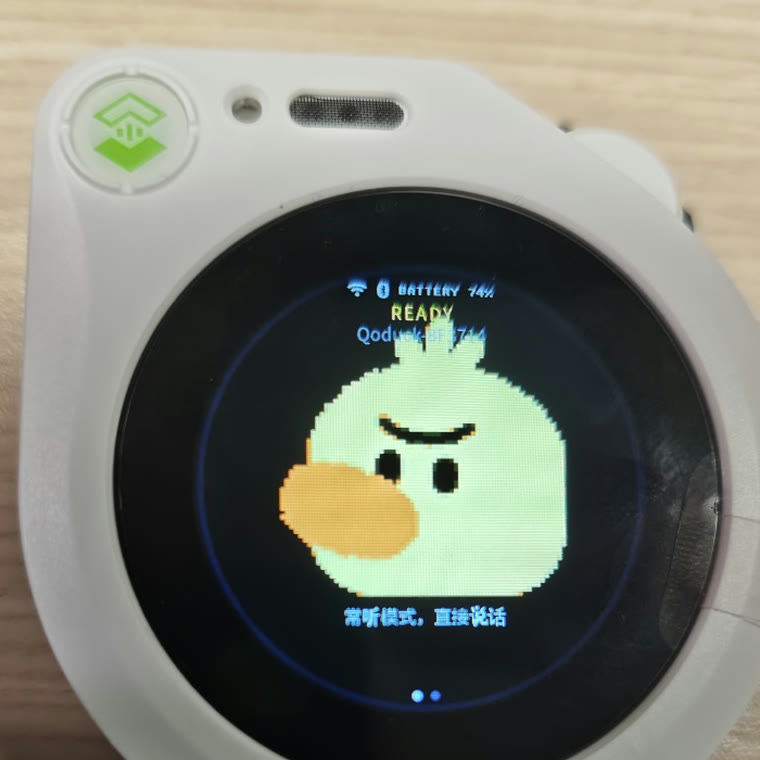

# Qoduck — 把 Qoder 云智能体做成一台桌面语音设备

[English](README.md) · **简体中文**

用一台小桌面设备直接和 [Qoder Cloud Agents](https://docs.qoder.com) 说话：不用按键，开口就行，
智能体用语音回答，屏幕上的一只鸭子会跟着动。

固件跑在 **Seeed SenseCAP Watcher** 上（ESP32-S3 + OV5647 摄像头 + 麦克风 + 喇叭 + 圆屏）。
它是 **[facebookincubator/muse-gadget-sdk](https://github.com/facebookincubator/muse-gadget-sdk)**
（Apache-2.0）的 fork：去掉了原来的 Muse 云端连接（`hatch.metaaivm.com`），换成直连
`api.qoder.com` 的实时语音 WebSocket。

<p align="center">
  
</p>
<p align="center"><sub>刷好固件的 SenseCAP Watcher：常听模式，说话时鸭子会跟着动</sub></p>

---

## 这是什么

（上图就是成品：白壳 SenseCAP Watcher，屏幕上 `READY`、设备名 `Qoduck-xxxx`，底下一行
「常听模式，直接说话」。）

把一个小桌面设备变成 **Qoder Cloud Agents 的语音终端**：不用按键，直接说话，智能体用语音回答，
屏幕上的一只鸭子会跟着呼吸、眨眼、说话时摇摆、思考时眯眼。

固件跑在 **Seeed SenseCAP Watcher** 上（ESP32-S3 + OV5647 摄像头 + 麦克风 + 喇叭 + 圆屏）。
它是 **[facebookincubator/muse-gadget-sdk](https://github.com/facebookincubator/muse-gadget-sdk)**
（Apache-2.0）的 fork：去掉了原来的 Muse 云端连接（`hatch.metaaivm.com`），换成直连
`api.qoder.com` 的实时语音 WebSocket。

```
 麦克风 ──► VAD ──► 16 kHz PCM ──┐
                                 │  wss://api.qoder.com/api/v1/forward/realtime
 喇叭 ◄── 24 kHz PCM ◄───────────┘  （Qoder 云智能体会话）
```

## 特点

* **默认常听**：设备端 VAD 检测到你说话就开上行；服务端做 VAD/ASR/大模型/TTS 并流式回音频。
  实测**说完到听到第一帧 1.0–2.5 秒**（简单闲聊约 1.0–1.6 秒，要查数据约 1.7–2.5 秒）。
* **本地界面**：圆屏鸭子表情（呼吸 + 眨眼 + 说话摇摆 + 思考眯眼）；滚轮菜单有音量、亮度、
  麦克风增益、自动息屏、手机配对、无线网络、状态、电池、重置蓝牙配对、关机。
* **不需要装 App**：Wi-Fi 和 Qoder token 都能用网页通过蓝牙推给设备，重启后保留。
* **记得住你**：Qoder 的记忆挂在身份上而不是挂在会话上，所以重启或开新会话后它还记得你的名字（见下文）。
* **纯 ESP-IDF**，除了一个 Qoder PAT 之外不需要接入任何账号体系。

## 硬件与价格（2026 年，购买前请核对官网）

| 渠道 | 价格 |
|---|---|
| [根派 GNPE](https://spotpear.cn/index.php/shop/SeeedStudio-SenseCAP-Watcher-ESP32-S3-N16R8-Physical-AI-Agent.html)（国内现货，小智版） | **¥269** |
| [Seeed 官方店](https://www.seeedstudio.com/SenseCAP-Watcher-W1-A-p-5979.html)（海外，含摄像头） | $60.99 |
| [sensecap.org](https://sensecap.org/product/sensecap-watcher-for-xiaozhi/) | $54.90 |
| [Seeed 中文官网](https://www.seeedstudio.com.cn/product/sensecap-watcher-the-physical-ai-agent-for-smarter-spaces) | 不标零售价，走企业询价 |

国内买最划算的是“小智版”：**¥269 上下**，硬件完全一样（ESP32-S3 + 8 MB PSRAM + 1.45 英寸 412×412 圆触屏 + 麦克风 + 1 W 喇叭），只是不带摄像头——而本项目的固件默认就没开摄像头
（`CONFIG_MUSE_WATCHER_CAMERA` 未启用），所以买便宜那版就够；带摄像头的版本约 ¥399。
硬件就这么多钱，仓库里的代码全部免费，自己编译自己烧。云端语音服务走你自己的 Qoder 账号
按量计费，价格以 [Qoder 官网](https://docs.qoder.com/zh/account/pricing) 为准。

## 编译与烧录

需要 **ESP-IDF v6.0.1**：

```sh
git clone -b v6.0.1 --recursive https://github.com/espressif/esp-idf.git ~/esp/esp-idf-v6
cd ~/esp/esp-idf-v6 && ./install.sh esp32s3 && . ./export.sh

cd muse-gadget-sdk/esp32
idf.py -B build-muse-sensecap-watcher -DIDF_TARGET=esp32s3 \
  -DSDKCONFIG=build-muse-sensecap-watcher/sdkconfig \
  -DSDKCONFIG_DEFAULTS="sdkconfig.defaults;devices/sdkconfig.muse;devices/sdkconfig.muse-sensecap-watcher" \
  build
idf.py -B build-muse-sensecap-watcher -p /dev/tty.usbmodemXXXX flash monitor
```

## 配置 Wi-Fi 与 Qoder token

**token 从哪来**：登录 Qoder，打开 [qoder.com/cloud/pat-keys](https://qoder.com/cloud/pat-keys)
（国内站：[qoder.com.cn/cloud/pat-keys](https://qoder.com.cn/cloud/pat-keys)），新建一个 Personal
Access Token。形如 `pt-...`，账单计到你自己的账号上。注意 token 分站点：在 `.com` 建的 token
打不通 `.cn` 的接口，你连哪个站就在哪个站建。

仓库里**不含任何凭据**，三种方式（优先级从高到低）：

1. **设备上直接填**：左右滑到 *设置 → QODER*，填 API 地址、Conversation、Access token。
2. **本地私有头文件** `esp32/components/qca_voice/qca_config.local.h`（已被 `.gitignore` 排除）：
   ```c
   #define QCA_TOKEN  "pt-..."
   #define QCA_WS_URL "wss://api.qoder.com/api/v1/forward/realtime?conversation_id=conv_..."
   ```
3. **编译参数**：`-DQCA_TOKEN=\"pt-...\"`。

Wi-Fi 也可以在设置页填，或者用仓库自带的网页通过蓝牙推送：
`esp32/tools/serve_setup.sh` 起服务，手机 Chrome 打开 `ble_setup.html`，
连上 `Qoduck-xxxx` 后填 SSID / 密码。
完整步骤（申请 Qoder PAT、拿 conversation id、手机端 Chrome 需要的 flag）见
[`skills/qoduck-setup/SKILL.md`](skills/qoduck-setup/SKILL.md)。

## 怎么用

| 手势 | 动作 |
|---|---|
| 直接说话 | 开始对话（常听模式） |
| 按一下滚轮 | 撸一下鸭子：蹦一下 + 两角飘心 |
| 双击滚轮 | 把它转晕：转一圈 + 头顶星星 + X 眼 |
| 转滚轮 | 东张西望 |
| 按住滚轮 1.2 秒 | 打瞌睡（闭眼 + Zzz） |
| 按住滚轮 2.4 秒 | 睡着（息屏） |
| 按住滚轮 4.2 秒 | 关机（先播 1.5 秒告别动画） |
| 双击转滚轮 | 开关手机蓝牙配网 |
| 左右滑动 | 切屏（状态 / 菜单） |
| 菜单里按滚轮 | 进入 / 选中 |
| 菜单「新会话」 | 开一段新上下文，记忆保留 |

## 记忆与新会话

这是两件事，值得分开说：

* **会话**（`conv_…`）是一段工作上下文。它由平台创建，越长越慢越贵，而且单条实时 WebSocket 最多
  只能挂 60 分钟，所以隔一阵子换一段新的比较健康。
* **记忆**不在会话里。Qoder 的 Memory Store 按 `(身份, 模板)` 这一对来存放，并自动挂载到这一对的
  每个 session 上，所以开新会话会继承旧会话学过的东西。

开新会话有三个入口：**设置 → QODER → 开新会话**、设置菜单里的**新会话**、或者串口：

```
qca> new                # 开新会话，记忆保留
qca> ids                # 看当前用的身份 / 模板
qca> ids idn_… tmpl_…   # 写进 NVS，只需一次
```

设备会先断掉 WebSocket 再建会话：建会话要一次 TLS 握手，而实时链路挂着的时候 ESP32-S3 内部 RAM
的连续块只剩 20 KB 左右。

记忆能写进去的前提是模板被授予了读写工具。`esp32/tools/qca/provision.mjs` 会给智能体 `Read`/`Write`，
并在人设里要求它记住你的长期信息（名字、城市、偏好），回答关于你的问题前先读记忆：

```
curl -H "Authorization: Bearer $QODER_PAT" \
     https://api.qoder.com/api/v1/forward/templates/tmpl_… | jq '.tools'
```

## 仓库结构

```
docs/                       # README 用的实机照片
esp32/
├── components/muse/        # Muse SDK（上游）、界面、菜单、配网
esp32/components/qca_voice/  # Qoder Cloud Agents 语音链路（新增）
esp32/main/                  # 程序入口、鸭子表情
esp32/devices/               # 各开发板的 sdkconfig 片段
esp32/tools/                 # ble_setup.html、serve_setup.sh、board.sh
skills/                      # 给智能体看的操作手册（设备 skill + qoduck-setup）
linux/                       # 主机侧 Muse CLI（上游）
```

## 已知限制

* 目前只有语音，摄像头画面还没送给智能体。
* 音频是 16 kHz 上 / 24 kHz 下的裸 PCM，走公网 Wi-Fi，弱网下会出现断续；插着 USB 供电更稳。
* 一台设备对应一个 Qoder conversation，可在设置页切换。
* 蓝牙配网页用的是 Web Bluetooth：必须 Chrome；如果页面走 `http://`，需要先在
  `chrome://flags/#unsafely-treat-insecure-origin-as-secure` 里把该地址加进白名单。

## 相关项目

* **[muse-gadget-sdk](https://github.com/facebookincubator/muse-gadget-sdk)**：本 fork 跟随的上游 SDK。
  板级配置、屏幕、音频驱动、USB 栈全部来自它；**本仓库保留了上游的提交历史**，Qoduck 的改动
  就是最上面的那一条提交（有问题能直接 `git log` 追溯到上游）。
* **[esp32-thinks](https://github.com/raullenchai/esp32-thinks)**：同一块板子上的另一条路（MIT，以 patch
  形式发布）。它保留“一问一答”的结构，把 STT / chat / TTS 三个端点指向任意 OpenAI 兼容服务；
  如果你要的是自己搭文本模型链路，看它；要的是直接和智能体会话本身说话，看这里。
* **[SenseCAP Watcher wiki](https://wiki.seeedstudio.com/watcher_hardware_overview/)**：硬件引脚、
  原理图和救砖步骤。

## 许可与致谢

Apache License 2.0，见 [LICENSE](LICENSE)。基于 Meta 的
[muse-gadget-sdk](https://github.com/facebookincubator/muse-gadget-sdk)，并保留其完整提交历史。
Qoder 是阿里云的服务，本项目只是独立客户端，与 Qoder、Seeed Studio 无隶属关系。
